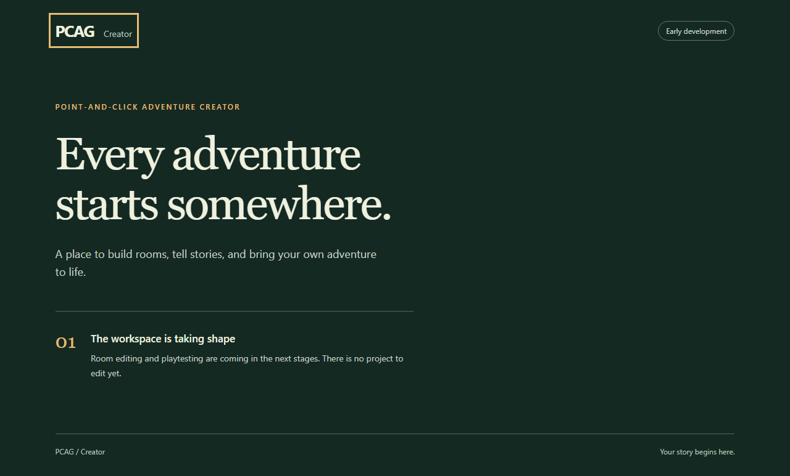

# F02 review: workspace and toolchain

Date: 2026-10-22. Status: Accepted. User acceptance: 2026-10-22 - "all good now, lets move into F03".

## Scope and acceptance

Establish a pinned TypeScript/React/Phaser toolchain, minimal creator and standalone player shells, documented development/production commands, strict type checks, a meaningful browser smoke test, and CI using the same checks. F01 was explicitly accepted before this item began.

Acceptance scenarios:

1. A clean lockfile install works on the documented Node/npm environment.
2. Creator and player each run locally and build to independent output directories.
3. React mounts the creator; Phaser boots in the player. These are setup shells, not an adventure or an authoring workflow.
4. Type checking covers both apps and test/build configuration. Browser smoke tests load production builds and concurrent development servers, and fail on boot/resource errors.
5. CI installs from the lockfile and runs the same type/build/browser checks; no hosted CI pass is claimed without an actual run.

Failure cases: unsupported Node versions; missing dependencies/assets; build errors hidden by transpilation; player depending on creator output; stale dev servers masking broken builds; accidentally implementing F03–F05.

## Results

F01 is accepted. F02 has a pinned toolchain, independent creator/player shells, strict checks, four browser smoke tests, and a CI workflow. F03 and later items remain Not started. No project schema, adventure runtime, authoring controls, persistence, or export packaging was implemented.

## Review it

1. Follow [developer setup](setup.md). Run `npm run dev` and `npm run dev:player` in separate terminals.
2. Open <http://127.0.0.1:5173/>: the creator welcome screen renders through React. Tab focuses the home link with a visible outline. The page states that there is no project to edit yet.
3. Open <http://127.0.0.1:5174/>: the player shows only a moonlit landscape in a full-width, centered 16:9 game frame. It works independently of the creator and can be embedded in an iframe.
4. Run `npm run check`: type checking and both builds pass, followed by six Chromium checks (boot and iframe-resize checks in production and development). Test servers use ports 4173/4174 and 5175/5176; manual review servers may stay running.
5. Inspect the [toolchain decision](../decisions/0002-rebuild-toolchain.md) and [CI workflow](../../.github/workflows/check.yml). Accept F02 or request changes; F03 starts only after explicit acceptance.

Screenshots from the production-browser run:

## Executed checks

Environment: Windows, Node 22.23.1, npm 10.9.8, Playwright 1.64.1, Chromium 156.0.8078.4. The browser version was also read from a launched browser with `browser.version()`.

| Command / inspection | Expected | Observed |
| --- | --- | --- |
| `npm view <package> version engines peerDependencies --json --offline=false` | Verify stable releases and compatible peers before install | Selected set recorded in the decision; no legacy versions copied |
| `npm install --cache .npm-cache --offline=false --fetch-retries=0 --fetch-timeout=30000` | Resolve exact pins and create lockfile | Passed; 31 packages installed, 0 audit findings reported |
| `npm ci --cache .npm-cache --offline=false --fetch-retries=0 --fetch-timeout=30000` | Recreate dependencies from lockfile | Passed; 31 packages installed, 0 audit findings reported |
| `npm ls --depth=0` | Installed direct versions match pins | All ten direct packages matched; no missing/invalid peers |
| `npx --no-install playwright install chromium` | Install the matching browser | Passed; Chromium/headless shell revision 1248 downloaded |
| `npm run check` | Type checks, two independent production builds, four browser checks | Passed; final browser run: 4 passed in 13.8 seconds |
| Screenshot inspection | Readable shells, visible focus, rendered stage, no overlapping text | Passed at the captured desktop viewport |
| `git diff --check` and `git diff --cached --check` | No whitespace errors | Passed |
| Local-link/backlog inspection | Changed-document links resolve; 24 backlog rows preserved; one active item | Passed; F01 Accepted, F02 Awaiting user validation, 22 Not started |

For this managed environment, the browser commands used `$env:PLAYWRIGHT_BROWSERS_PATH=Join-Path (Get-Location) '.playwright'`. Set this in a new PowerShell terminal to reuse the local download, or install into Playwright's normal cache as described in setup. npm's environment initially forced offline mode; explicit `--offline=false` enabled registry access. Vite's first sandboxed build hit `spawn EPERM`; the same build passed with authorized child-process access. These were execution-environment restrictions, not code changes or ignored test failures.

## Failure found and fixed

The first production run passed two tests, but checking both development servers found a 504 “Outdated Optimize Dep” response for Phaser. Both app roots used the default dependency cache. Assigned each app its own `node_modules/.vite/<app>` cache, then expanded the tests to boot both development servers concurrently as well as both production builds. The final four-test run passed with no browser console errors, page errors, failed requests, or HTTP error responses.

## Limits and next gate

Review correction (2026-10-22): the user reported a blank creator page. Reproduced HTTP 504 responses for React's optimized modules on port 5173. App-specific caches alone were insufficient: smoke-test and manual-review instances of the same app still shared a cache. Both Vite configs now separate caches by app and mode; test development servers use `--mode smoke`, while manual review uses the default development mode. Ran `npm run check` again: all four checks passed (13.6 seconds). Then loaded and reloaded the original review URLs on ports 5173 and 5174 in Chromium: both rendered with no HTTP or browser errors. Reload an already-open blank tab to fetch the current module URLs. F02 remains awaiting user validation.

- Vite reports a player chunk-size warning: the Phaser-containing JS bundle is about 1,368.43 kB minified / 357.73 kB gzip. The creator JS is about 220.69 kB / 69.04 kB gzip. The warning is retained; F02 makes no performance guarantee.
- Only local Windows Chromium behavior was executed. GitHub Actions is configured for Linux, but no hosted run has been performed. Firefox, Safari, Edge qualification, mobile controls, and full accessibility testing remain later work.
- Phaser's decorative boot scene is not the shared adventure renderer or preview lifecycle proof. Those belong to F04. No audio or project loading is exercised here.
- The normal test output also contains a harmless inherited `NO_COLOR`/`FORCE_COLOR` warning. It does not affect the four browser assertions.
- M0 is incomplete; F03–F05 and the integrated milestone gate are still required.

Commits: `e5cfd40` records F01 acceptance/F02 scope; `0c9f7ea` adds the verified workspace, shells, tests, and CI. The final review/evidence commit follows those milestones.

## Player presentation revision (2026-10-22)

At the user's request, replaced the branded player page with an embeddable game-only view. The canvas is 1600 x 900, scales to full container width at 16:9, and centers vertically in taller containers. Added an original SVG moonlit landscape as the sample game background and a dark surrounding background. Removed all visible page copy; assistive-technology readiness remains. This presentation revision does not introduce project schema or gameplay.

Validation: `npm run check` passed both builds, strict type checks, and all six browser checks (21.2 seconds). The new iframe cases verify no header/footer/title, full-width canvas, 16:9 proportions, and vertical centering at 640px and 360px widths in a 520px-high embed. The initial run exposed Phaser's inability to decode Vite's inlined SVG URL; importing the background with `?no-inline` fixed both development and production loading. Visually inspected the updated production screenshot. See [setup](setup.md#embed-the-player) for iframe markup. The player screenshot below the review steps is updated to the new view.
